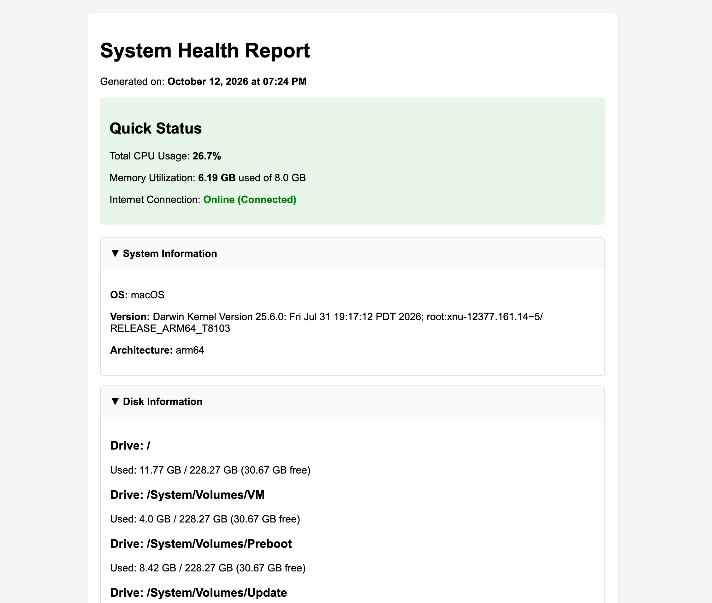
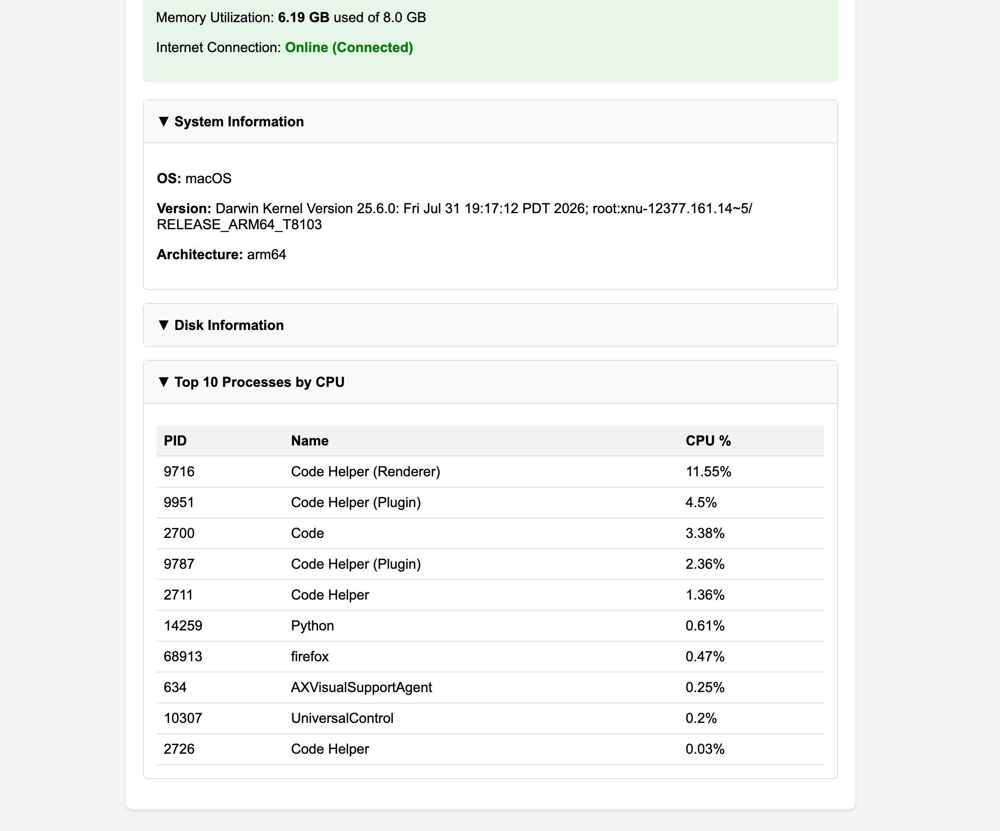

# Python System Health & Diagnostic Tool

A lightweight script that checks computer health (CPU, RAM, Disk, Network) and instantly turns the data into a clean HTML report. 

---

## What It Does
* **Performance Stats:** Pulls live stats on CPU load, memory usage, and storage.
* **Network Check:** Validates local adapter status and tests active internet connectivity.
* **HTML Dashboard:** Automatically generates a visual report for easy troubleshooting.

---

## Built With
* **Python**
* **psutil** (System metrics)
* **Jinja2** (HTML rendering)

---

## Preview

  
  

